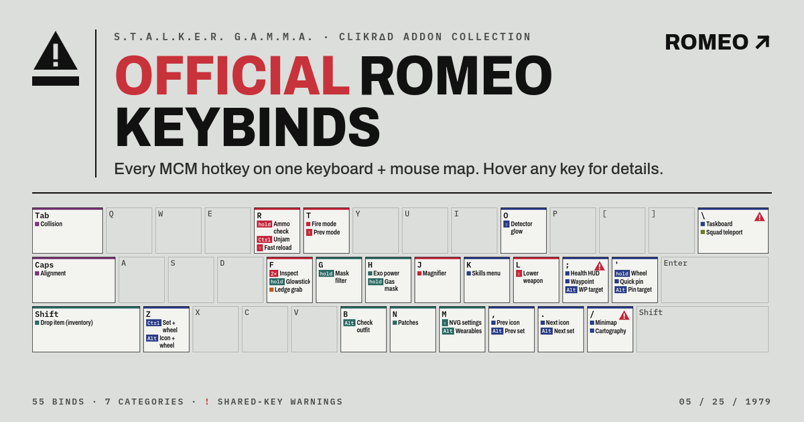

# Official ROMEO Keybinds

Every MCM hotkey that the **CLIKRΔD ROMEO** addon collection for S.T.A.L.K.E.R. G.A.M.M.A. sets, on one interactive keyboard and mouse map.

**[Open the interactive page →](https://bluded.github.io/romeo-keybinds/)**

## Downloads

| File | What it is |
|---|---|
| [`romeo-keybinds-keyboard.png`](romeo-keybinds-keyboard.png) | Keyboard and mouse map, plus the shared-key, tap/hold and cinematic camera notes |
| [`romeo-keybinds-full-list.png`](romeo-keybinds-full-list.png) | Every bind grouped by category |
| [`romeo-keybinds.pdf`](romeo-keybinds.pdf) | Both sheets as a 2-page PDF |

## Using the page

- **Hover or tap a key** to see every action on it, which mod it comes from, and its key code.
- **Click a category** (Weapons & optics, Gear & survival, and so on) to highlight only those keys. Click it again to clear.
- **Notation on the keys:** `⇧` = Shift +, `Ctrl` = Ctrl +, `Alt` = Alt +, `hold` = hold the key, `2×` = double-tap.
- A **red warning triangle** on a key means two mods fire on the exact same input.

It works in any modern browser, including on phones.

## Good to know

- **Only MCM hotkeys are shown.** Movement, reload, use and the other base-game binds aren't listed, because ROMEO doesn't change them.
- **MCM is the source of truth.** If your game behaves differently, check the mod's page in the MCM menu (Esc → MCM). You can rebind any of these keys there too.
- **Shared keys.** `/`, `\`, `;`, `Num 1` and `Num 3` each trigger two mods with the same press. Rebind one of them in MCM if that gets in the way.
- **Tap vs. hold.** `F`, `H`, `'` and `R` do different things on tap and hold. A tap-mode action fires as soon as the key goes down, so holding the key can trigger it as well.
- **Hideout furniture keys** (`Home`, `Tab`, `Caps Lock`) only do something in Hideout Furniture placement mode.
- **Cinematic camera.** `-` starts the fly camera, which takes over every key until you exit with `-` or `Esc`. Inside it: `W A S D` move, `Ctrl` + `W`/`S` go up/down, `Shift` is fast, `V` toggles slow, and the mouse wheel cycles speed.

## All binds

★ = a mod that ROMEO adds on top of base GAMMA.

### CLIKRΔD

| Input | Action | Mod |
|---|---|---|
| `-` | Cinematic camera on/off | Cinematic Camera — CLIKRΔD ★ |
| `Num 1` | Open lean position editor | Lean v2 — CLIKRΔD ★ |

### Weapons & optics

| Input | Action | Mod |
|---|---|---|
| `R` (hold) | Ammo check | Ammo Check Enhanced Rework ★ |
| `Ctrl` + `R` | Unjam | Ammo Check Enhanced Rework ★ |
| `Shift` + `R` | Fast reload | Ammo Check Enhanced Rework ★ |
| `T` | Next fire mode | Ammo Check Enhanced Rework ★ |
| `Shift` + `T` | Previous fire mode | Ammo Check Enhanced Rework ★ |
| `F` (double-tap) | Inspect weapon | Inspect Weapons Expanded ★ |
| `Shift` + `L` | Lower weapon | Lower Weapon Sprint |
| `=` | Reflex sight reticle switch | 3DSS for GAMMA |
| `J` | Magnifier switch | 3DSS for GAMMA |
| `Num +` | Toggle scope (tap: attach/detach · 2×: next scope) | Toggle Scope |
| `Shift` + `Num +` | Scope view: move weapon further | 3DSS scope FOV |
| `Shift` + `Num -` | Scope view: move weapon closer | 3DSS scope FOV |
| `Shift` + `Backspace` | Scope view: reset current weapon | 3DSS scope FOV |
| `Num 3` | Laser settings panel | Laser Settings |
| `Mouse 5` | Manual weapon tilt | Weapon Cover Tilt |

### Gear & survival

| Input | Action | Mod |
|---|---|---|
| `F` (hold) | Throw glowstick | Glowsticks (GAMMA Starting Loadouts) |
| `G` (hold) | Toggle gas mask filter | Toxic Air Redux ★ |
| `H` | Exo PSU power | Powered Exos |
| `H` (hold) | Gas mask equip/unequip | FDDA Redone |
| `Alt` + `B` | Check outfit animation | FDDA Redone |
| `Shift` + `M` | NVG settings panel | Better Beef's NVGs ★ |
| `Alt` + `M` | Wearable devices menu | Wearable Devices ★ |
| `Mouse 4` | Watch (tap: Promin inspect · hold: look at watch) | Wearable Devices ★ |
| `N` | Attach patches | Attach Patches with hotkey |
| `Left Shift` | Drop hovered item (inventory) | GAMMA Press Key to Drop Item |
| `Left Alt` | Autoloot | Autolooter |

### PDA, HUD & map

| Input | Action | Mod |
|---|---|---|
| `K` | Skills menu | Skill System |
| `Shift` + `O` | Detector glow settings | DAR Emissive Glow ★ |
| `;` | Toggle health HUD | Body Health System (GAMMA Meds) |
| `;` | Waypoint on/off | Personal Adjustable Waypoint |
| `Alt` + `;` | Set waypoint on target | Personal Adjustable Waypoint |
| `'` (hold) | Quick action wheel | Quick Action Wheel |
| `'` | Quick pin | Personal Adjustable Waypoint |
| `Alt` + `'` | Pin on target object | Personal Adjustable Waypoint |
| `/` | Minimap toggle | Minimap Toggle |
| `/` | Cartography mode | Personal Adjustable Waypoint |
| `\` | PDA taskboard | PDA Taskboard |
| `,` | Previous pin icon | Personal Adjustable Waypoint |
| `Alt` + `,` | Previous pin set | Personal Adjustable Waypoint |
| `.` | Next pin icon | Personal Adjustable Waypoint |
| `Alt` + `.` | Next pin set | Personal Adjustable Waypoint |
| `Ctrl` + `Z` | Hold + mouse wheel: change pin set | Personal Adjustable Waypoint |
| `Alt` + `Z` | Hold + mouse wheel: change pin icon | Personal Adjustable Waypoint |

### Companions

| Input | Action | Mod |
|---|---|---|
| `\` | Teleport squad to you | Fair Fast Travel |
| `Num 1` | Companions: cycle readiness | Useful Idiots (REDone Combat AI) ★ |
| `Num 2` | Companions: cycle movement | Useful Idiots (REDone Combat AI) ★ |
| `Num 3` | Companions: move to point | Useful Idiots (REDone Combat AI) ★ |
| `Num 4` | Companions: cycle stance | Useful Idiots (REDone Combat AI) ★ |
| `Num 5` | Companions: loot corpses | Useful Idiots (REDone Combat AI) ★ |

### Hideout furniture

| Input | Action | Mod |
|---|---|---|
| `Home` | Furniture placement mode | Hideout Furniture |
| `Tab` | Furniture: toggle collision check | Hideout Furniture |
| `Caps Lock` | Furniture: player / surface alignment | Hideout Furniture |

### Movement

| Input | Action | Mod |
|---|---|---|
| `F` | Grab ledge | Ledge Grabbing |

## Where the data comes from

The binds were read from ROMEO's MCM values file and checked against the ROMEO mod profile:

- `GAMMA/mods/xx-CLIKRΔD MCM Values/gamedata/configs/axr_options.ltx` holds the key values.
- `GAMMA/profiles/CLIKRΔD - ROMEO/modlist.txt` says which mods are enabled.

Each key entry was matched to the enabled mod whose MCM menu reads it. Entries for mods that aren't enabled in ROMEO are left out; the file still carries keys for Dynamic Hipfire, Dynamic Viewmodel, Mags Redux, older 3DSS and free-zoom options, and a few others. Free Zoom F.O.C sets its own key to none, so it isn't listed.

**Key codes.** The game stores keys as DirectInput codes ("DIK"), so the file says `= 19` rather than `R`. The page shows these codes next to each bind. Mouse buttons use Anomaly's own codes: `337` = Mouse 1 through `341` = Mouse 5.

**MCM modifier and mode values.** In MCM, modifiers are `0` none, `1` Shift, `2` Ctrl, `3` Alt, and modes are `0` press, `1` double-tap, `2` hold. A few mods number these differently, and each bind was checked against its own mod's MCM script.

## Credits

- **ROMEO** addon collection by **CLIKRΔD GROUP**.
- **S.T.A.L.K.E.R. G.A.M.M.A.** by Grokitach and the GAMMA team.
- The features behind these hotkeys come from the individual mods and their authors, named in the tables above.
- S.T.A.L.K.E.R. is a trademark of GSC Game World.
- Fonts: [Archivo](https://fonts.google.com/specimen/Archivo) and [IBM Plex Mono](https://fonts.google.com/specimen/IBM+Plex+Mono), both under the SIL Open Font License.
